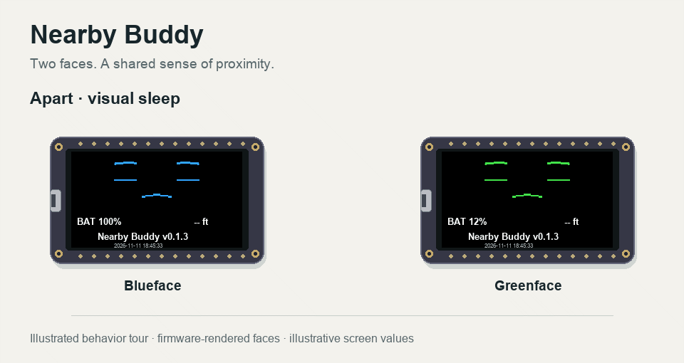
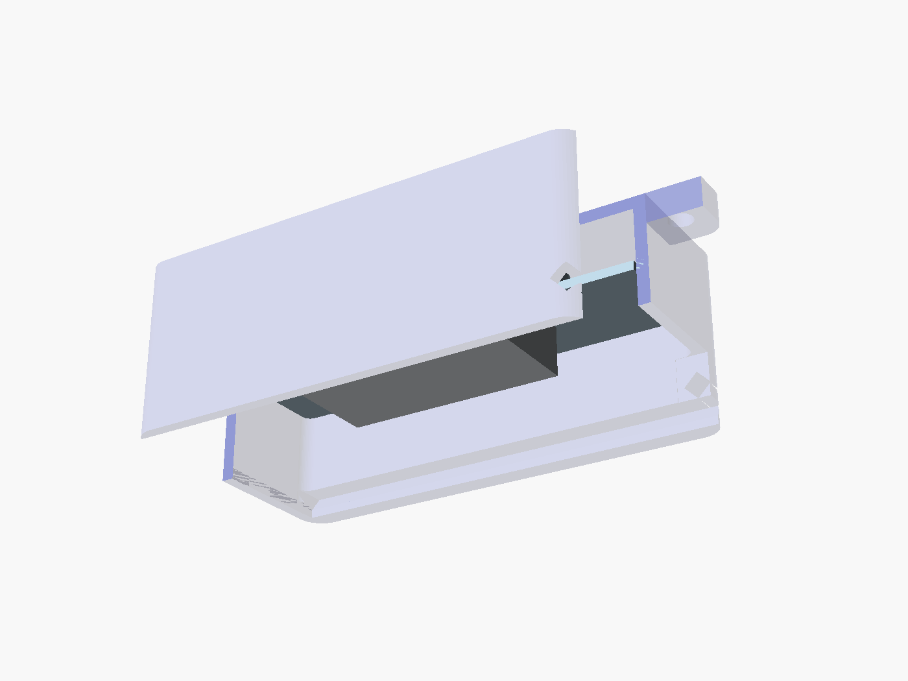

# Nearby Buddy

Two small faces become happier as they approach each other. Blueface is quick and exuberant. Greenface has a slower rhythm and an asymmetrical smile.



**18-second illustrated behavior tour.** The faces use the firmware's procedural renderer, expression definitions and damped animation. Board bodies are stylized illustrations. Motion, mood sequencing and screen values are illustrative. The tour shows the intended experience; physical distance and contact detection still need calibration.

[Animated SVG](docs/images/nearby-buddy-motion.svg) · [Device render](docs/images/nearby-buddy-devices.png) · [Firmware](firmware/NearbyBuddy/NearbyBuddy.ino) · [Measured trials](TRIALS.md) · [Download this project](https://github.com/yury-g/nearby-buddy/archive/refs/heads/main.zip)

## Printable enclosure and 3D fit viewer



[Enclosure README, print files and prompts](enclosure/README.md) · [Front assembly render](enclosure/images/assembled-front.png) · [Exploded view](enclosure/images/exploded.png) · [Interactive 3D viewer — download and open locally](enclosure/viewer/index.html)

Four printed parts use a keyed sliding lid and removable locking pin. The screen, D0/BOOT, D1, D2 and front RESET remain exposed; the duplicate rear RESET has tool access. A **52 × 27 × 12 mm battery bay** accommodates the selected Adafruit 3898 and a larger **50 × 25 × 10 mm target envelope**. Physical fit remains untested. The viewer contains all geometry and works offline after download; GitHub shows its source rather than running it.

## Lab handoff · v0.1.3

Work stopped on November 11, 2026 at the owner's request, with **both physical boards running v0.1.3**, build `2026-11-11T18:45:33`. The next orientation experiment was deferred.

The latest change extended fast mode's scan window from 60 to 100 ms per 100 ms interval. At a measured six-foot stationary placement, each board completed a 45-second capture with **zero sad or sleep transitions**. The longest received-report gaps were **0.522 s on Blue** and **0.317 s on Green**. Earlier fast-mode trials had multi-second gaps and false sleep. Upload hashes, live versions, radio startup and host tests were verified.

Distance and mood thresholds remain provisional. Earlier measurements underestimated physical distance, and both boards danced at one foot. Touching had a stronger median signal than a one-inch gap in the tested orientation, but reliable contact detection has not been established. Battery-only runtime, power cost, approach latency and body/orientation effects remain open lab work. [Evidence and procedures](TRIALS.md)

**Prototype only.** The faces run on the original pair, but distance accuracy, runtime and physical enclosure fit are unfinished.

## What the toy does

| When the partner seems… | Intended expression |
| --- | --- |
| Far away or absent | Sad, then closed eyes |
| Approaching | Smile, then happiness |
| Very close | Elation and a playful face dance |
| Moving away | Return toward sadness and rest |

Closed eyes are visual sleep while Bluetooth discovery continues. Dancing is screen animation. Application buttons have no assigned actions; hardware BOOT and RESET remain available.

Each board broadcasts a non-connectable Bluetooth LE advertisement and scans for its enrolled partner. It estimates proximity from RSSI, filters the signal and independently chooses an expression. A computer can listen to advertisements. USB provides commands and detailed telemetry.

## Hardware

- Two **Adafruit Feather ESP32-S3 Reverse TFT** boards with 135 × 240 displays and onboard MAX17048 battery gauges.
- USB data cables and a computer for building, uploading and logging.
- Adafruit **3898, 3.7 V 400 mAh LiPo**, or another electrically compatible pack that fits the enclosure. Check polarity, charge/discharge ratings and the actual connector before use.
- A tape measure and a clear surface.

The original enrolled pair is below. USB port names can change after resets.

| Role | Factory MAC | Last normal port on the owner's Mac |
| --- | --- | --- |
| Blueface | `b8:f8:62:d5:8b:8c` | `/dev/cu.usbmodem1101` |
| Greenface | `ac:27:6e:b1:cb:b0` | `/dev/cu.usbmodem101` |

**Using your own boards?** Read both factory MACs and update `identities` in the [sketch](firmware/NearbyBuddy/NearbyBuddy.ino), plus `IDENTITIES` in [boards.py](tools/boards.py). Keep Blue first and Green second. The sketch selects its role from that identity and rejects unknown hardware. Enrollment is a classroom pairing convention with no authentication.

## Build and run

Download [the project ZIP](https://github.com/yury-g/nearby-buddy/archive/refs/heads/main.zip) and extract it, or clone `https://github.com/yury-g/nearby-buddy.git`. Commands below run from the repository directory containing this README.

The verified environment was native macOS arm64, Arduino CLI 1.4.1, Arduino-ESP32 **3.3.8**, Arduino IDE 2.3.8 and Adafruit GFX **1.12.6**. Fresh setup on student computers remains to be verified.

1. Install Arduino IDE or Arduino CLI. Add [Espressif's board package URL](https://espressif.github.io/arduino-esp32/package_esp32_index.json) in Boards Manager and install `esp32` version 3.3.8. Install Adafruit GFX Library version 1.12.6 and its requested dependencies.
2. Select **Adafruit Feather ESP32-S3 Reverse TFT**. Use USB-OTG application mode, CDC enabled on boot, TinyUF2 4 MB No OTA, and full-chip erase disabled.
3. Resolve each physical identity before selecting an upload port. Close other Serial Monitors that own the port.
4. Preserve source and obtain a verified full-flash backup before a board's first replacement. Read the [recovery notes](HANDOFF.md#recovery-and-upload-notes). The old `backup_flash.py` helper has a known stub-transfer failure and needs repair before reuse.
5. Compile and run the host checks.

```sh
python3 tools/boards.py list
python3 tools/boards.py doctor
python3 tools/boards.py build firmware/NearbyBuddy
clang++ -std=c++17 -Ifirmware/NearbyBuddy tests/proximity.cpp -o build/proximity-test
./build/proximity-test
```

The FQBN is `esp32:esp32:adafruit_feather_esp32s3_reversetft`. The helper builds under ignored `build/`. On macOS, `clang++` comes with the Command Line Tools. Other hosts may use a compatible C++17 compiler.

Open `firmware/NearbyBuddy/NearbyBuddy.ino` in Arduino IDE and upload the same sketch to each identity-verified board. UART0 / Hardware CDC upload mode worked when the original boards were in ROM mode, while application USB mode remained USB-OTG. If automatic reset fails, hold BOOT, tap RESET and release BOOT, then rediscover the ROM port and check its factory identity. [Recovery record](HANDOFF.md)

After uploading, open Serial Monitor at **115200 baud with New Line**, send `status` and confirm the correct face name, version, `adv=0`, `scan=0` and increasing `peer` count when the partner is powered. Verify the screen shows the colored face, battery percentage, approximate feet, firmware version and build timestamp.

## Try it over USB

| Command | Result |
| --- | --- |
| `status` | Version, build, radio status, peer counts, signal, age, feet, mood and battery |
| `fast` | 100 ms advertising; 100 ms scan window per 100 ms |
| `eco` | Experimental 250 ms advertising; 45 ms scan window per 240 ms |
| `raw on` / `raw off` | Enable or disable per-report RSSI logging |
| `mark LABEL` | Insert a named marker in a recorded trial |
| `demo` | Run an 18-second synthetic expression tour, then return to live behavior |

For an expression demonstration, use `demo` on each board. For a physical experiment, let that tour finish, confirm `demo=0` and record a marked trial. Save raw logs locally under `evidence/` and summarize them.

```sh
python3 tools/summarize_rssi.py evidence/blue-fast.txt
```

The display uses `-- ft` for a stale or absent partner, `~<1 ft` and `~>12 ft` at its ends, and half-foot rounding in between. Its formula uses −64 dBm at one meter and a path-loss exponent of 2.2, pending calibration. Battery percentage comes from the gauge, with the display clamped to 0–100%. Gauge rate estimates change in state of charge; it does not measure current in mA.

## Continue the lab work

1. Repeat the six-foot v0.1.3 baseline, then rotate Green 180 degrees in place and record the change.
2. Repeat marked distances with hands clear, in hands and with a body between the boards. Record edge-to-edge and antenna-to-antenna geometry. Added obstruction is its own test condition.
3. Calibrate feet and mood thresholds using repeatable measurements from both receivers. Check contact against small air gaps across orientations.
4. Measure approach/separation response and false transitions. Recheck reception gaps after changes.
5. Compare profiles and battery-only operation with comparable charge, display state and duration. Record gauge change in percentage points per hour, or use a current logger for mA.

The earlier sweep covered touching through six feet. An obstructed setup was initially labeled nine feet and then corrected; exclude it from distance calibration. [Trial details](TRIALS.md)

## Copy this into your AI assistant

Copy the whole block into ChatGPT, Codex or another assistant that can read repository files. If it cannot browse GitHub, attach the extracted project ZIP. For USB uploads and local builds, the assistant needs local filesystem, terminal and serial access; a chat-only assistant can guide you through running commands yourself.

```text
Help me understand, set up and continue Nearby Buddy, a student-lab prototype.

Start by reading this project README:
https://github.com/yury-g/nearby-buddy/blob/main/README.md

If I provided an extracted project or attached files, use those local files.
Read README.md, HANDOFF.md, TRIALS.md, ROADMAP.md and AGENTS.md. Then inspect
firmware/NearbyBuddy/NearbyBuddy.ino, Face.h and Proximity.h before proposing changes.

The saved checkpoint is v0.1.3 on two Adafruit Feather ESP32-S3 Reverse TFT boards.
Fast mode uses 100 ms advertising and a 100/100 ms scan window.
A stationary six-foot trial showed no false sleep during 45 seconds per board.
Distance calibration, reliable contact discrimination, orientation/body effects
and battery-only measurements remain unfinished. The README animation is an
illustrated synthetic tour.

First summarize the checkpoint and ask what hardware and computer I have and
whether I want to learn the code, run the demo or continue experiments.
Check whether you have local terminal, filesystem and serial access. If not, give
me one command at a time and wait for its output. Clone the public repository
or use my local copy, install the pinned dependencies, build without uploading,
then identify the USB-connected boards. Do not guess that a port is my board.
Once the baseline works, explain one small proposed change, implement it, run
the relevant checks and record the result. Keep firmware and CAD prototype-only.
Reuse the existing renderer and preserve attribution.
For different boards, identify their factory MACs and update enrollment in both
the sketch and tools/boards.py. Resolve identity before every upload.
Preserve existing firmware with a verified full-flash backup before replacement.
The existing backup_flash.py helper has a known failure; read the recovery notes.

Use hardware evidence for physical claims. Keep synthetic demos labeled.
Keep binaries, private backups and raw logs out of Git. Explain experiments in
plain language, make bounded changes, and update the README, trial record and
handoff with what was measured and what remains open.
```

## Find the code

| File | Purpose |
| --- | --- |
| [NearbyBuddy.ino](firmware/NearbyBuddy/NearbyBuddy.ino) | Identities, BLE, serial commands and battery telemetry |
| [Face.h](firmware/NearbyBuddy/Face.h) | TFT, footer, expressions and personality |
| [Proximity.h](firmware/NearbyBuddy/Proximity.h) | Signal filter, distance formula, dwell and thresholds |
| [Host test](tests/proximity.cpp) | Synthetic checks of proximity logic |
| [Board helper](tools/boards.py) | Port discovery, identity matching, build and monitor |
| [Log summarizer](tools/summarize_rssi.py) | Marked RSSI segments and report-gap statistics |
| [TRIALS.md](TRIALS.md) | Measurements and procedures |
| [HANDOFF.md](HANDOFF.md) | Stopping point, recovery and remaining work |

## Share and extend

This standalone public repository contains just Nearby Buddy, including the firmware, enclosure, visual tour and student handoff. [Download all files](https://github.com/yury-g/nearby-buddy/archive/refs/heads/main.zip). Private recovery images, raw logs and unrelated OpenToy projects are excluded.

## Prototype roadmap

All code and CAD here are for **prototyping and supervised learning only**. A shipped product needs production hardening, security, safety and reliability validation. The current enclosure has digital checks but has not been printed or physically fitted.

1. **Distance calibration and validation:** repeated measured distances, orientation/body effects, approach/separation latency, false transitions and contact versus small gaps.
2. **Sip battery power:** measure real current and battery-only runtime; reduce scan/display duty; evaluate very small batteries and verify their peak-current and charging limits.
3. **Over-the-air programming:** design authenticated updates, a suitable partition layout, recovery and rollback. The current build uses **No OTA** and updates over USB.
4. **Production hardening:** authenticated pairing, robust state/error handling, reproducible releases, fault testing, thermal/charging checks, mechanical retention and enclosure durability.

See [ROADMAP.md](ROADMAP.md) for concrete acceptance criteria.

## Credits and license

Nearby Buddy reuses OpenToy's procedural face curves and damped animation, with the original MIT license preserved under [src/opentoy](firmware/NearbyBuddy/src/opentoy/LICENSE). TFT orientation, power-rail setup and RGB565 adaptation were informed by the owner's Battery Faces project. This project includes the source needed for its build.

Project source, new illustrations and documentation use the [MIT license](LICENSE). Arduino-ESP32 and Adafruit libraries retain their licenses. The visual exporter uses Pillow under its [included license](docs/PILLOW-LICENSE.txt). [Visual generation notes](docs/VISUALS.md)

## Research sources

- ESP32-S3 Wi-Fi FTM capabilities and limitations — https://docs.espressif.com/projects/esp-idf/en/latest/esp32s3/api-guides/wifi-driver/security-and-roaming.html
- ESP-NOW receive metadata — https://docs.espressif.com/projects/esp-idf/en/v5.0.7/esp32s3/migration-guides/release-5.x/networking.html
- Bluetooth SIG discussion of RSSI ranging and channel sounding — https://www.bluetooth.com/bluetooth-le-primer/
- Arduino CLI — https://arduino.github.io/arduino-cli/latest/
- ESP32-S3 flash readback reference — https://docs.espressif.com/projects/esptool/en/release-v4/esp32s3/esptool/basic-commands.html

These are research leads checked November 11, 2026. Confirm API/version compatibility before implementation.

- NimBLE host advertising and scanning — https://mynewt.apache.org/latest/network/ble_hs/ble_gap.html
- ESP32-S3 Bluetooth capabilities — https://documentation.espressif.com/esp32_s3_datasheet_en.pdf
- Adafruit Reverse TFT Feather power rails — https://learn.adafruit.com/esp32-s3-reverse-tft-feather/power-management
- MAX17048 gauge telemetry — https://www.analog.com/media/en/technical-documentation/data-sheets/MAX17048-MAX17049.pdf
