# Nearby Buddy enclosure

A roomy, four-part prototype enclosure for the **Adafruit 5691 ESP32-S3 Reverse TFT Feather** and an internal LiPo. The front screen and four front buttons remain exposed. USB is accessible, and a tool hole reaches the duplicate RESET on the rear. The battery sits behind an insulating carrier deck. A keyed sliding rear lid closes the case; a removable printed key locks it. No screws, glue for the housing, or generated print supports are intended.

**Status: digitally checked, not yet printed or physically fitted.** All code and CAD are for prototyping. A shipped product requires production hardening and mechanical, charging, thermal and reliability validation.

[Back to firmware](../README.md) · [Editable OpenSCAD](cad/nearby-buddy.scad) · [Print STLs](stl) · [Dimension sources](DIMENSIONS.md) · [Fit-check results](FIT-CHECK.json)

## Parts and supplies

The [main parts list](../README.md#parts-list-for-two-buddies) links the exact board, selected battery, USB cable and print files, with quantities for a pair. **Per enclosure:** one Adafruit 5691, one 3898 battery (or a separately validated replacement), four printed parts, a thin removable battery-safe adhesive pad and optional lightweight strap/key tether. A larger 50 × 25 × 10 mm battery is shown as a fit envelope only; no larger pack has been selected or electrically qualified.

## Inspect it before printing

Download the repository ZIP, then double-click **`enclosure/viewer/index.html`**. The [interactive viewer](viewer/index.html) works offline with embedded geometry. Orbit, zoom, explode, hide parts, change shell opacity and switch from the 3898 to a larger battery, and choose Blueface or Greenface with its native screen graphic. GitHub displays HTML source rather than running the viewer. Individual [STL files](stl) also have GitHub's 3D preview.

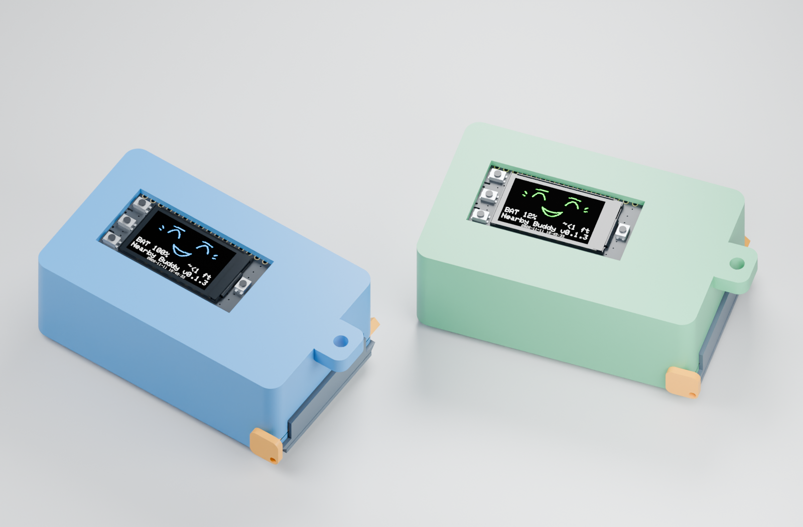

| Front isometric · screen on | Rear isometric · closed |
| --- | --- |
| 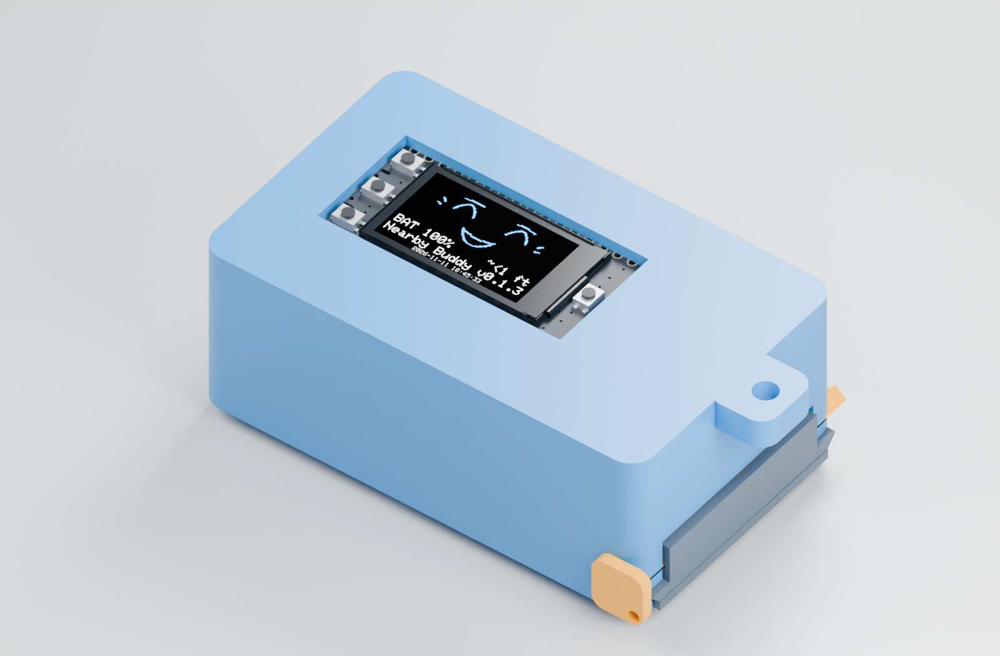 | 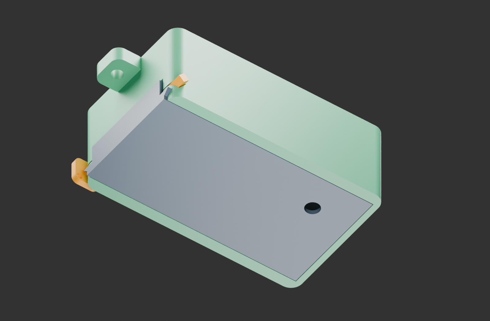 |

| Interior · shell and lid hidden | Exploded assembly |
| --- | --- |
| 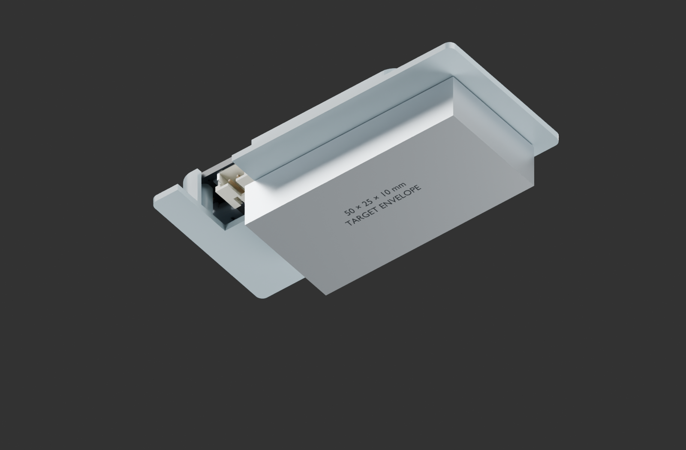 | 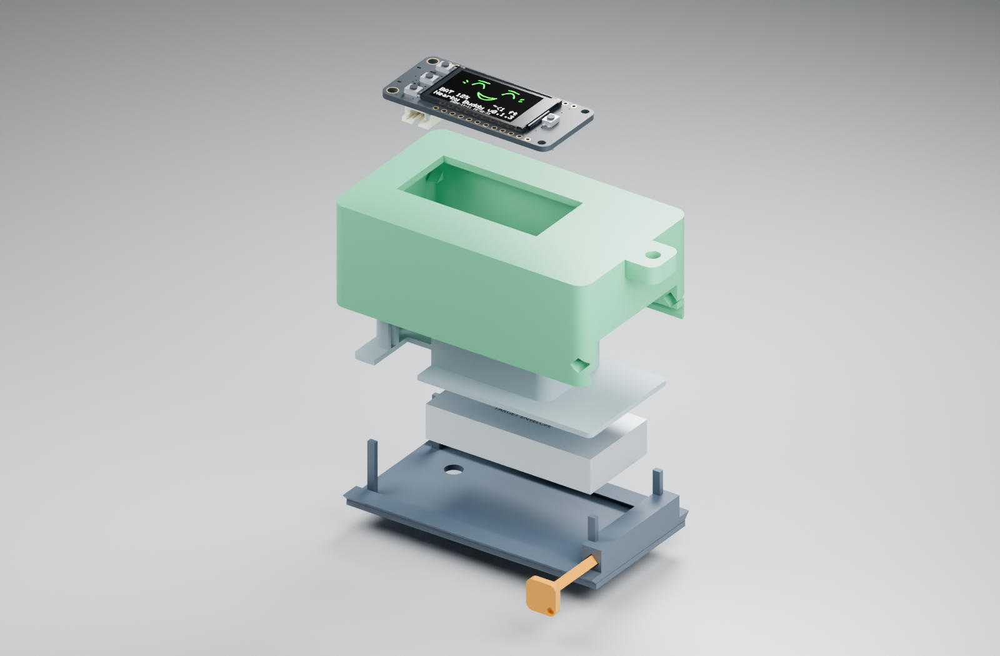 |

These Blender views use the same vendor board vertices and enclosure meshes as the fit checks. Colors and lighting are visual choices. Screen graphics use Nearby Buddy's native renderer with synthetic telemetry; the battery is a dimensional envelope, not a detailed product model. [Rebuild the renders / editable Blender scene](STUDIO.md).

### Technical inspection views

| Front isometric | Rear isometric |
| --- | --- |
| 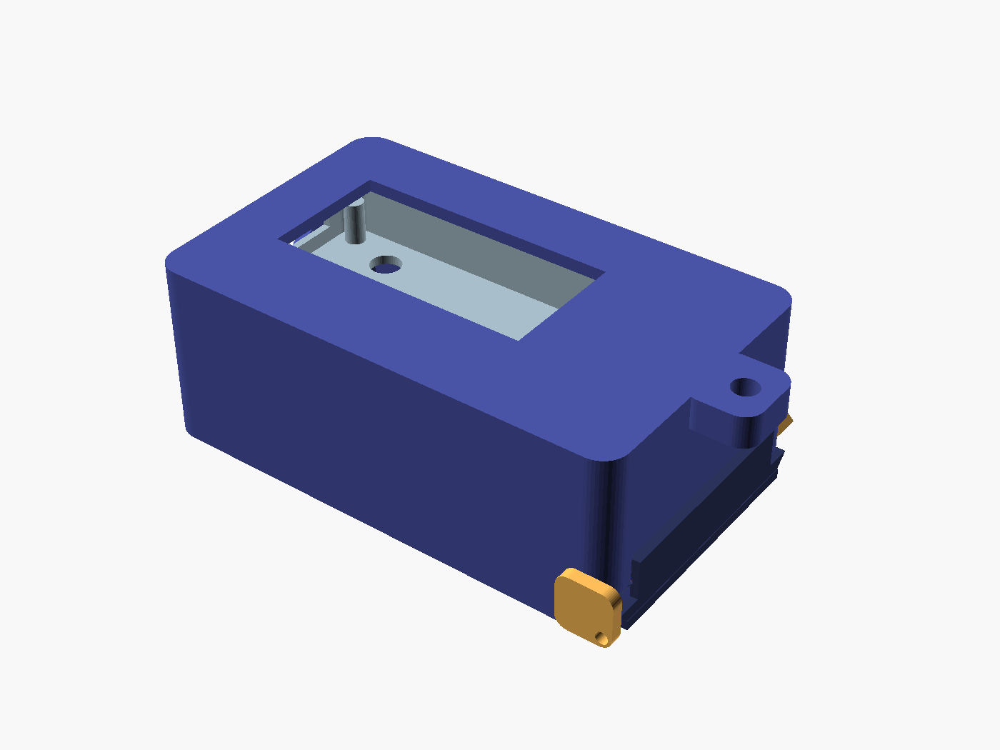 | 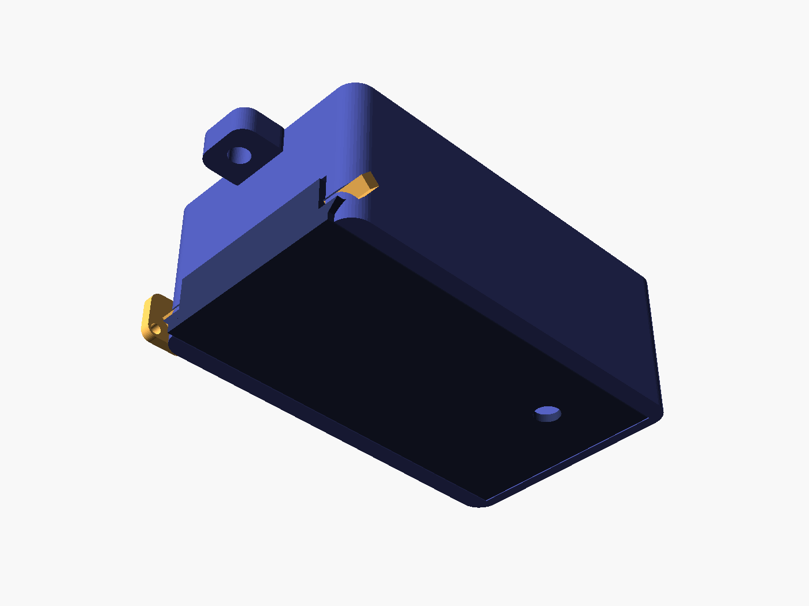 |
| 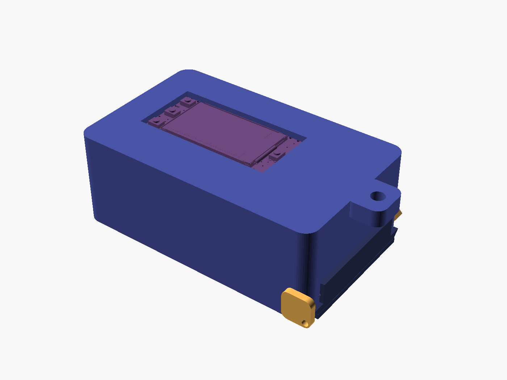 |  |
| 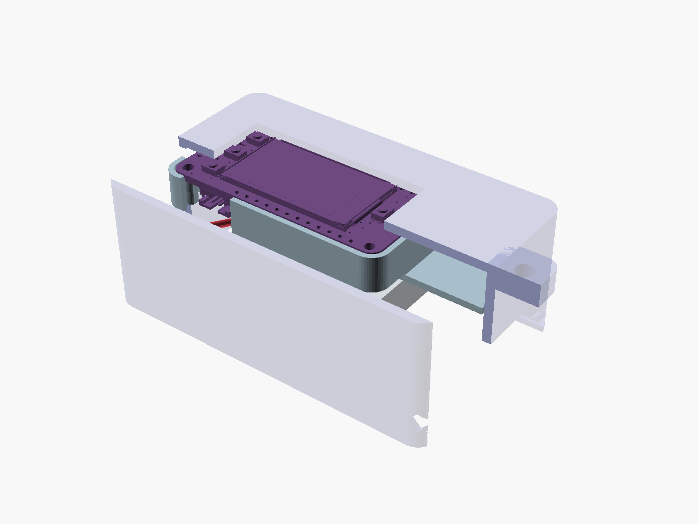 | 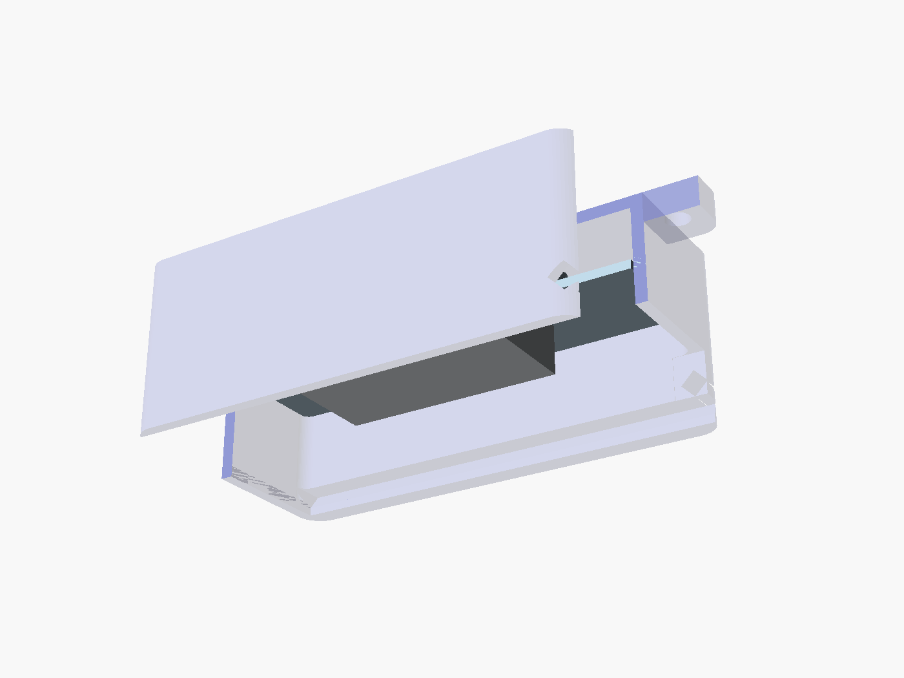 |

The closed rear view naturally hides the battery. The sectioned views remove the lid and part of the shell/deck so the actual placement is visible. Purple is the vendor board model, silver is the battery envelope, pale blue is the carrier and gold is the locking key. These are CAD renders, not photographs or physical-fit evidence.

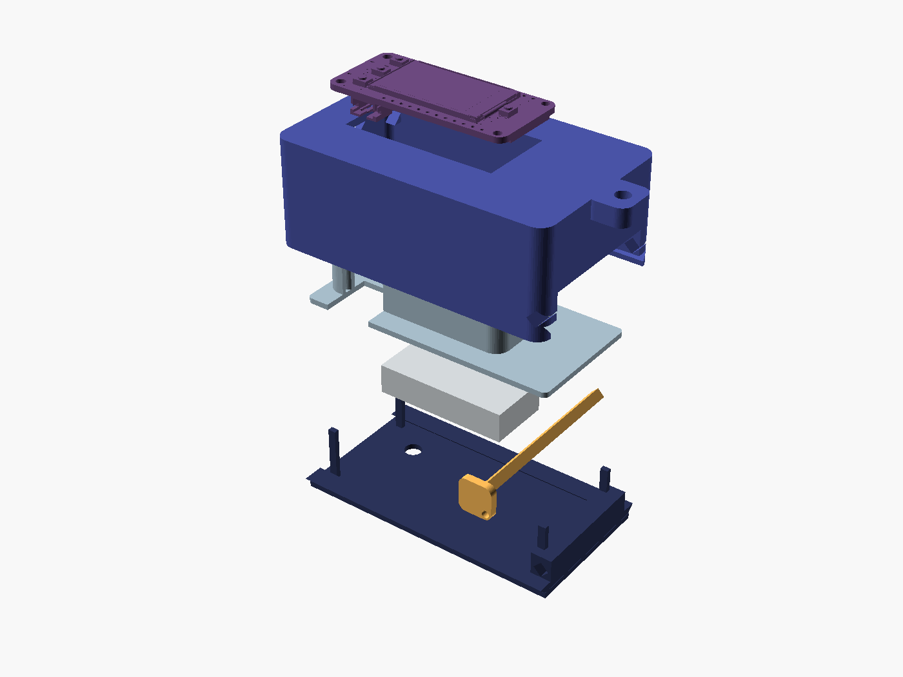

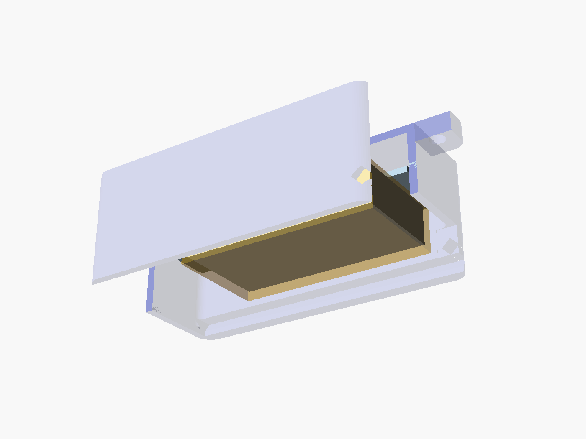

## Battery room

The **52 × 27 × 12 mm bay** is intentionally generous. The supplied Adafruit 3898 is modeled at its datasheet maximum **37 × 17.5 × 8.2 mm**, not the smaller approximate shop dimensions. A second model shows a **50 × 25 × 10 mm target battery**. Capacity in mAh does not determine dimensions; measure any replacement and check its polarity, charging and peak-current ratings.

Use a removable battery-safe foam adhesive to attach the pouch to the underside of the carrier, with wires facing the connector/service bay. Keep the pouch clear of sharp print defects and closing joints. Extra air is intentional; do not fill it by compressing the cell. The rear RESET tool channel remains beside the battery. There is no external battery pocket.

## Print and assemble

Start with [joint-coupon.stl](stl/joint-coupon.stl) and the key to test printer clearance before printing the full case. The coupon includes a short rail receiver and matching slider placed separately on the bed.

| Print file | Orientation already in STL | Initial settings |
| --- | --- | --- |
| [shell.stl](stl/shell.stl) | Front face on bed; cavity upward | 0.2 mm layers, 0.4 mm nozzle, 3–4 walls, 20% infill, supports off |
| [carrier.stl](stl/carrier.stl) | Flat deck on bed; posts and edge fence upward | Same; inspect the four support pads |
| [lid.stl](stl/lid.stl) | Flat rear face on bed; rails upward | Same; keep rails free of elephant foot |
| [key.stl](stl/key.stl) | Broad head on bed; shaft vertical | Same; use a brim for the tall narrow shaft |

PLA is a reasonable first fit-print material. Revalidate clearances and retention after changing material or printer. The source uses 45° slopes instead of unsupported roofs. A geometric overhang screen is included in the validation; slicer inspection and the first physical print are still required. `*_assembly.stl`, `board.stl`, `battery.stl`, `larger-battery.stl`, `plug.stl`, `wires.stl` and `bay.stl` are visualization/fit references, not print parts.

1. Print the joint coupon, slide its two pieces together and check key fit. Adjust `rail_clearance` or `key_clearance` in small increments if needed; regenerate and verify the whole model.
2. Dry-fit the empty parts. The lid slides in from the end opposite USB; the key inserts sideways through the aligned lid and shell holes. Tether the key through its head hole so it cannot be lost.
3. With power disconnected, place the Feather screen-down against the front bezel, then insert the carrier from the open back. Its fence locates the PCB; four solid pads support the mounting annuli. Use the model orientation—USB toward the short left end. The carrier tabs seat against the internal stops.
4. Check D0/BOOT, D1, D2, front RESET and rear RESET access. Confirm a USB plug inserts without loading the PCB.
5. Fit the battery under the carrier with removable foam adhesive. Route its leads through the open service bay and connect the JST before closing. The nominal 25 ± 5 mm leads and actual mating plug require a physical check. The illustrated centerline is about 20 mm before bend slack, so a minimum-length lead may need a correctly polarized short extension. Never force a stretched lead or trap it in the rail.
6. Slide in the rear lid, align the key holes, insert the key and check retention. The lid supports the carrier independently of the pouch. Use the integral eyelet for a lightweight strap; load and drop performance remain untested.

## How this was made

We read Adafruit's Eagle PCB coordinates, inspected its official STL, and used the battery datasheet's maximum dimensions. We then created a parametric OpenSCAD shell, locating carrier, captive sliding lid and printed locking key. The model keeps the board rigidly rotated screen-up, provides a separate battery/lead volume and uses support-free print orientations.

Digital checks cover watertight connected print meshes, intersections between printed parts, the full battery bay, the two battery envelopes and a reserved mating-plug volume. Vendor board components are checked as valid solids where possible and conservative bounding boxes for surface-only components. The supplied board model contains some non-solid surfaces, so a single naive boolean on that STL would be unreliable. See [FIT-CHECK.json](FIT-CHECK.json) for the actual result and limitations.

Rebuild from the repository root with OpenSCAD on PATH:

```sh
python3 enclosure/tools/build.py
python3 -m venv build/cad-venv
build/cad-venv/bin/pip install -r enclosure/tools/requirements.txt
build/cad-venv/bin/python enclosure/tools/verify.py
build/cad-venv/bin/python enclosure/tools/prepare_studio.py
python3 enclosure/tools/make_viewer.py
# Optional studio renders (Blender 4.5 LTS on PATH):
blender --background --python enclosure/tools/render_studio.py
```

The CAD parameters are editable. Changing `bay` alone does not automatically relocate every board support, service channel and joint; inspect and update the dependent geometry, then rerun verification. Preserve the exact vendor reference and its license. The viewer needs no online libraries or accounts.

## Prompt 1 — make a source-based enclosure like this

```text
Help me make a printable enclosure for an electronic prototype. Begin with
https://github.com/yury-g/nearby-buddy/blob/main/enclosure/README.md
Read DIMENSIONS.md, the OpenSCAD source, reference/SOURCES.json and FIT-CHECK.json.
Use the manufacturer's PCB CAD, 3D model and battery datasheet maximum dimensions.
Separate vendor dimensions from chosen tolerances. Do not estimate critical fit
from a screenshot. Ask for the board revision and actual battery/plug dimensions
if those are missing.

For this example use Adafruit 5691 Reverse TFT Feather and Adafruit 3898 LiPo.
Keep the display and every button accessible, including both RESET switches.
Provide USB access, an internal battery bay, a protected wire/connector route,
and separation from the PCB. Allow a larger battery target of 50 x 25 x 10 mm
inside a 52 x 27 x 12 mm bay. Use no screw fasteners and no generated supports;
prefer keyed sliding parts and a removable locking key. Supply a joint coupon.

Create editable CAD, print-oriented STLs, front/rear isometric renders, interior
and exploded views, and a 3D viewer with the actual board and battery envelopes.
Check connected watertight meshes, solid interference and steep overhangs.
Document how to print, assemble, measure and tune tolerances. Preserve licenses.
Label digital fit separately from physical fit. This is prototype CAD, not a
production-qualified housing. Finish with a first-print validation procedure.
```

## Prompt 2 — get this project onto my connected boards and iterate

```text
Help me set up Nearby Buddy from https://github.com/yury-g/nearby-buddy.
Read README.md, AGENTS.md, HANDOFF.md, TRIALS.md, ROADMAP.md and enclosure/README.md.
Ask what computer, two boards, batteries and printer I have. Verify your local
filesystem, terminal and USB serial capabilities; if you lack them, guide me
through commands and wait for output. Clone or download the repo into a folder
I choose, inspect the pinned tool versions and build the unchanged firmware.

Identify both USB-connected boards by factory MAC, map Blue and Green, preserve
their current firmware with verified full-flash backups and update enrollment
in the sketch and tools/boards.py. The old backup helper has a documented failure;
read the recovery notes instead of blindly trusting it. Upload only after the
board identity and backup are verified. Confirm status/version and run demo.

For the enclosure, open the offline viewer, compare my actual battery and plug
with DIMENSIONS.md, print the joint coupon and dry-fit empty parts first. Keep
wires and the LiPo away from closing joints. Then make one bounded code or CAD
change, explain it, run relevant checks, compare with baseline and update docs.
Do not treat RSSI as validated distance or CAD clearance as proven physical fit.
All work remains a prototype; follow the roadmap toward calibration, low power,
secure OTA and production hardening only through measured, documented steps.
```

## License

Original enclosure, scripts, viewer and documentation: [MIT](../LICENSE). Bundled vendor STL and its rendered geometry: © Adafruit Industries under the [included MIT license](reference/ADAFRUIT-LICENSE.txt). Eagle layout was consulted for dimensions; its original license remains with that separate source. Battery dimensional facts are cited in [DIMENSIONS.md](DIMENSIONS.md).

The classic bitmap font used in the screen textures is from Adafruit GFX 1.12.6, under its [included BSD license](reference/ADAFRUIT-GFX-LICENSE.txt).
