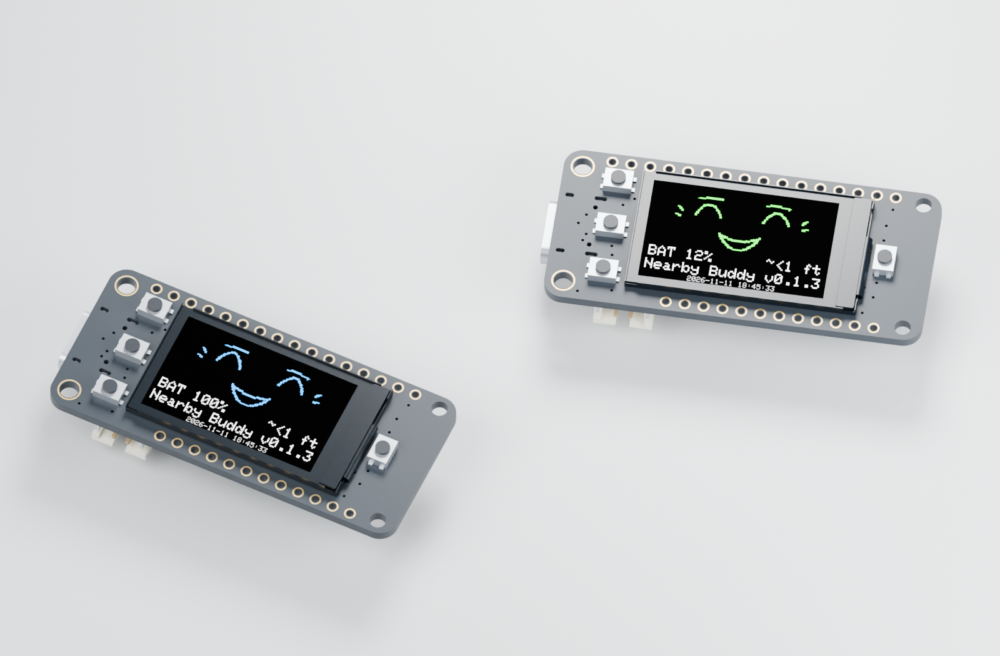

# CAD geometry + native screen pixels

The presentation follows the owner's Battery Faces approach: preserve screen pixels, keep related devices at a common physical scale, and label synthetic readings. Here we use Adafruit's actual Feather 3D model instead of a simplified board silhouette.



## What is accurate, and what is illustrative

- **Geometry:** [Adafruit's supplied STL](reference/SOURCES.json), rigidly rotated into the enclosure coordinate system. Its vertices are unchanged. The manufacturer model defines the PCB, screen, switches, USB and rear components. It remains a vendor reference, not a metrology survey of a particular board revision.
- **Screens:** 240 × 135 PNGs generated from the included face renderer and expression code. The face is resampled with the same integer layout as `Face.h`; footer text uses the bundled classic Adafruit GFX font and firmware coordinates. Values are synthetic: Blue 100%, Green 12%, both `~<1 ft`; these are not live readings or captured measurements.
- **Screen placement:** active plane bounds from the vendor model are x = 12.336…37.246, y = 4.092…18.952 mm. A texture plane sits at z = 28.249 mm, just above the modeled panel at 28.2446 mm. The native raster maps to that physical area. Pixels are not assumed to be physically square.
- **Appearance:** PCB, metals, plastic, battery foil, enclosure colors and studio lighting are visualization choices. Gold header/mount annuli are visual details using Eagle coordinates; silkscreen and tiny component markings are omitted. These are CAD renders, not photographs.
- **Battery:** the 3898 uses maximum datasheet dimensions; the larger block is a 50 × 25 × 10 mm target envelope. Cosmetic foil/label shading is not an exact model of either pouch, its protection circuit, seams or connector. Printed geometry and fit checks do not use the cosmetic screen or plating.
- **Scale:** each Blender scene uses one millimeter-to-meter conversion for every object. Pair renders use an orthographic camera, so board sizes remain directly comparable. Screen brightness and lighting do not imply real display performance.

## Open and modify the studio

Download [nearby-buddy.blend](studio/nearby-buddy.blend) with **Raw / Download raw file**, then open it in Blender 4.5 LTS or compatible. This packed scene contains the two enclosed devices, their internal boards/battery envelopes, camera, lights and both screen textures. Select the camera or use numpad 0 for its staged view. Hide shell/lid objects to inspect the interior. All scene coordinates use meters with millimeters displayed.

The [offline 3D viewer](viewer/index.html) is the simpler option for rotating, hiding parts and switching battery size or face color. Download it first; GitHub does not execute HTML.

## Reproduce all six views

Run from the repository root after generating the CAD meshes:

```sh
python3 -m venv build/cad-venv
build/cad-venv/bin/pip install -r enclosure/tools/requirements.txt
build/cad-venv/bin/python enclosure/tools/prepare_studio.py
python3 enclosure/tools/make_viewer.py
blender --background --python enclosure/tools/render_studio.py
```

`prepare_studio.py` needs a C++17 compiler named `clang++` and the included firmware source. It compiles the existing visual harness under ignored `build/studio/`, creates screen textures, and groups vendor geometry for cosmetic materials. `make_viewer.py` embeds all geometry, vertex colors and PNGs, with no network or CDN dependencies. `render_studio.py` uses Blender 4.5.9 LTS / Cycles CPU, 32 samples with denoising. It writes six PNGs and a packed, editable `.blend` scene. Run the same scripts after changing the face renderer, screen layout or geometry; keep the generated output with the source.

To change the enclosure's fit, edit [OpenSCAD](cad/nearby-buddy.scad), rebuild meshes and run [verify.py](tools/verify.py). Do not use a cosmetic Blender edit as the manufacturing source. A digital clearance check still requires a physical first-print test.

## Prompt for another AI assistant

```text
Read https://github.com/yury-g/nearby-buddy/blob/main/enclosure/STUDIO.md
and the linked source, CAD attribution and enclosure README. Reproduce the
existing studio before changing it. Preserve the vendor's physical geometry
and map the project's native screen pixels onto the documented active panel.
Keep screens, battery values and cosmetic materials honestly labeled. Use one
physical scale for all objects. Supply front/rear, interior and exploded views,
a packed editable Blender scene, and an offline rotating viewer. Verify that
the screen is oriented correctly and visible through the actual opening.
Do not change printable geometry just to improve a render; rebuild and recheck
fit separately when a mechanical change is intentional.
```

Vendor geometry © Adafruit Industries, MIT. Classic GFX font © Adafruit Industries, BSD; see [font license](reference/ADAFRUIT-GFX-LICENSE.txt). New scripts and scene use the [project MIT license](../LICENSE).
